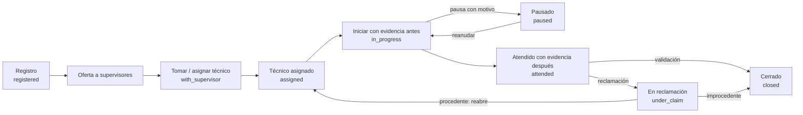

# Uso: flujo de un tiquet

## Objeto

Describe el ciclo completo de un tiquet en Axia: qué contiene, cómo cambia de estado, qué se
requiere para iniciar y cerrar, y qué elementos puede acumular durante su atención. Está dirigida a
quien opera la plataforma y a quien necesita entender el flujo sin leer el diseño técnico.

> **Nota:** la fuente de verdad del negocio es [`negocio.md`](../concepts/negocio.md). Este documento es una
> guía de referencia consistente con ella; ante cualquier contradicción, manda la especificación.

## 1. Qué es un tiquet

Una **solicitud de mantenimiento** con seguimiento exacto: en todo momento tiene un estado y, si no
avanza, un **motivo** con sus subestados. Cada movimiento queda en el historial con quién, cuándo y
cuánto duró, y cada paso puede llevar evidencia.

Un tiquet contiene:

| Elemento | Descripción |
|---|---|
| Folio | Identificador legible por patrón configurable (p. ej. `AX-2026-123`). Nunca cambia |
| Número | Consecutivo global, para ordenar y contar |
| Estado | Uno de los estados de la sección 2 |
| Ciclo de atención | Vuelta de trabajo; inicia en 1 y sube al reabrirse |
| Captura | Edificio, ubicación, dependencia, categoría → subcategoría → problema, tipo de servicio, prioridad, canal, descripción y contacto |
| Equipo | Se deriva de la categoría y se guarda como instantánea |
| Solicitante | Registro del catálogo (con cuenta o sin cuenta) |
| Marcas | Fecha de registro, fecha de cierre, posible duplicado y estado previo al descarte |

## 2. Estados

Los estados son **lógica fija**, no configurables.

| Código | Etiqueta | Significado |
|---|---|---|
| `registered` | Registrado | Creado y ofrecido a supervisores; nadie lo ha tomado |
| `with_supervisor` | Con supervisor | Un supervisor lo tomó y decide o asigna técnico |
| `assigned` | Asignado | Técnico asignado; aún no inicia |
| `in_progress` | En proceso | Trabajo iniciado |
| `paused` | Pausado | No puede avanzar; lleva motivo y subestados |
| `attended` | Atendido | El técnico terminó; pendiente de validación |
| `under_claim` | En reclamación | Hay una reclamación abierta |
| `closed` | Cerrado | Validado y finalizado |
| `rejected` | Rechazado | Descartado, con motivo |
| `cancelled` | Cancelado | Cancelado, con motivo |
| `duplicate` | Duplicado | Repetido de otro; cerrado y enlazado al original |

Los estados `rejected`, `cancelled` y `duplicate` son **de descarte** y admiten reactivación.

> **Nota:** la especificación original proponía un estado `pending_recapture` ("recaptura por
> aprobar"). La decisión confirmada fue la recaptura **sin aprobación** (se aplica y se avisa), por
> lo que ese estado no forma parte del modelo.

## 3. Flujo principal

En cualquier momento pueden aparecer **ramas**: reasignación de supervisor, recaptura, rechazo,
cancelación o marca de duplicado.

## 4. Ciclo de vida paso a paso

1. **Registro.** Quien tiene permiso llena la captura y el contacto. Antes de confirmar se ejecuta
   la detección de posibles duplicados, que **avisa y no bloquea**. La evidencia de tipo `request`
   es opcional pero muy recomendada. El tiquet nace en `registered`.
2. **Ruteo.** El sistema ofrece el tiquet a los **supervisores candidatos**: los del equipo del
   tiquet cuyo ámbito cubre el edificio. Sin candidatos, queda en la cola de administradores como
   "sin ruteo" y se genera una alerta.
3. **Tomar o asignar técnico.** Tomar una oferta pasa a `with_supervisor` y retira las ofertas de
   los demás (se conservan en el historial). Asignar técnico implica tomarlo y pasa a `assigned`.
   Si la persona no está designada a la categoría, su participación cuenta como apoyo auxiliar.
4. **Reasignar supervisor.** Solo quien tiene el tiquet (o un administrador), con motivo
   obligatorio. Vuelve a `registered` para el nuevo destinatario y su tiempo se mide como
   reasignación.
5. **Revisión del técnico.** Confirma la captura, propone una recalificación de datos
   (recaptura) o marca el tiquet como duplicado.
6. **Evidencia "antes" e inicio.** El técnico toma la evidencia `before` al llegar y **inicia** el
   trabajo. Sin esa evidencia no se puede iniciar. Pasa a `in_progress`.
7. **Pausas.** Cuando el tiquet no puede avanzar, se pausa con un motivo del catálogo jerárquico
   (niveles ilimitados), con nota y fecha estimada opcionales. Puede avanzar de subestado y cada
   paso queda registrado con su fecha. Un tiquet tiene como máximo una pausa abierta. Reanudar
   vuelve a `in_progress`.
8. **Atendido.** El técnico marca atendido con la descripción del trabajo y la evidencia `after`
   del ciclo. Sin esa evidencia no se puede marcar atendido. Pasa a `attended`.
9. **Validación y cierre.** La política es de la instancia: solo solicitante, solo supervisor, o
   ambos en cualquier orden. Cumplida la política, pasa a `closed` y se registra la fecha de
   cierre. La validación automática tras N días está apagada por defecto. La calificación de
   satisfacción (1 a 5) es siempre opcional.
10. **Reclamación.** La abren el solicitante, un supervisor o un administrador (nunca el técnico)
    mientras el tiquet esté `attended` o dentro de la ventana posterior al cierre (la semilla usa
    1 día). Exige motivo, descripción y evidencia `claim`, y pasa a `under_claim`. Al resolverla:
    - **Procedente:** se reabre en un ciclo nuevo, en `assigned` con el mismo técnico, salvo que el
      supervisor cambie la asignación.
    - **Improcedente:** queda `closed`.
    - **Requiere tiquet nuevo:** vuelve a su estado previo y se crea uno enlazado como derivado.
11. **Rechazo y cancelación.** Con motivo jerárquico y nota opcional. La mala captura no es motivo
    de rechazo: se corrige con recaptura. Los estados resultantes son `rejected` y `cancelled`, y
    guardan el estado previo para una posible reactivación.
12. **Marcar duplicado.** Puede hacerlo cualquier persona que participe en el flujo del tiquet;
    exige enlazar al tiquet original. Pasa a `duplicate`, avisa al solicitante y queda fuera de los
    indicadores de desempeño.
13. **Reactivación.** Un administrador reactiva un tiquet descartado con motivo; vuelve al **estado
    que tenía justo antes de descartarse**. El intervalo descartado no cuenta para el tiempo neto.
14. **Recaptura.** Corrige la captura **sobre el mismo tiquet**, conservando el original y cada
    versión. Se aplica y se avisa; no hay aprobaciones. Si cambia el equipo, el edificio o el
    técnico ya no corresponde, el tiquet vuelve al supervisor.
15. **Ajustes.** Cambiar la prioridad (supervisor o administrador), comentar (nota interna) y
    ajustar la hora de una acción (supervisor o administrador).

## 5. Matriz de transiciones

| Origen | Acción | Quién | Precondiciones | Efecto |
|---|---|---|---|---|
| — | Registrar | Permiso de crear (y de crear a nombre de otro) | Captura completa; detección de duplicados | `registered` y ofertas |
| `registered` | Tomar | Candidato con permiso de tomar oferta | Oferta activa | `with_supervisor` |
| `registered` / `with_supervisor` | Asignar técnico | Supervisor o administrador | Técnico del catálogo | `assigned` |
| `with_supervisor` | Reasignar supervisor | Quien lo tiene o administrador | Motivo | `registered`, recalcula ofertas |
| `assigned` | Iniciar | Técnico o proxy | Evidencia `before` | `in_progress` |
| `assigned` / `in_progress` / `paused` | Recapturar | Técnico, supervisor o administrador | Motivo | Aplica la captura; puede volver al supervisor |
| `in_progress` | Pausar | Técnico, supervisor o administrador | Motivo | `paused` |
| `paused` | Avanzar subestado | Con permiso | Nodo hijo válido | Avanza el subestado |
| `paused` | Reanudar | Con permiso | — | `in_progress` |
| `in_progress` | Marcar atendido | Técnico o proxy | Evidencia `after` y descripción | `attended` |
| `attended` | Validar | Según la política | Validaciones requeridas ("primero gana") | `closed` |
| `attended` / `closed` (en ventana) | Abrir reclamación | Solicitante, supervisor o administrador | Motivo, descripción y evidencia `claim` | `under_claim` |
| `under_claim` | Resolver reclamación | Supervisor o administrador | Resultado | Reabre, cierra o crea tiquet nuevo |
| Varios | Rechazar / cancelar | Con permiso | Motivo | `rejected` / `cancelled` |
| Varios | Marcar duplicado | Participante del flujo | Enlaza el original | `duplicate` |
| Descartados | Reactivar | Administrador | Motivo | Vuelve al estado previo al descarte |
| No final | Cambiar prioridad | Supervisor o administrador | — | Ajusta la prioridad |
| `closed` | Calificar | Solicitante o proxy | — | Calificación 1 a 5 |

## 6. Qué puede acumular un tiquet

| Elemento | Detalle |
|---|---|
| Participantes | Un líder (técnico asignado) y auxiliares (técnicos o supervisores), con inicio, fin y categoría |
| Pausas | Motivo jerárquico y subestados; cada paso con su fecha. Máximo una abierta |
| Reclamaciones | Motivo, descripción, evidencia, resultado y notas |
| Evidencias | `request` (opcional), `before` y `after` (obligatorias por ciclo), `during` (opcional, con el paso "Registrar avance"), `claim` (en reclamación) y `other` (solo con el permiso de evidencia libre). Nunca se borran; cada tipo solo se adjunta en su momento |
| Enlaces | Duplicado de, derivado de, relacionado con y bloqueado por |
| Historial | Bitácora de solo agregar con cada cambio, asignación, pausa, recaptura, reclamación, comentario o evidencia |
| Tiempos | Tramos con inicio y fin y clasificación de reloj, de origen del sistema o manual |
| Calificación | Satisfacción de 1 a 5 con comentario, opcional |
| Notificaciones | Avisos por destinatario, con reglas configurables |

### La pantalla de detalle

- El **estado actual** aparece como insignia junto al folio; no hay barra de avance por etapas.
- En pantallas angostas el orden es **acciones → estado → actividad → evidencias**; en escritorio la
  actividad se mantiene en la columna lateral.
- Las evidencias de imagen se ven completas, sin recorte. Al pulsarlas se abre un visor ampliado que
  se cierra con Escape o con el botón de cerrar.
- Los formularios de acción validan sus campos obligatorios antes de enviar y muestran el error en el
  campo correspondiente; una acción incompleta no llega al servidor.

## 7. Tiempos

Los tramos se distinguen por tipo: respuesta del supervisor, reasignación, asignación de técnico,
recaptura, espera de inicio, trabajo activo, pausa, validación, reclamación y revisión de duplicado.

- **Tiempo total:** continuo desde el registro hasta el cierre final. Incluye reasignaciones,
  recapturas, pausas, reclamaciones y reaperturas.
- **Tiempo neto:** el total menos los tramos clasificados como no contables.
- **Versión laboral:** la intersección de cada tramo con el calendario del equipo o de la persona,
  sin festivos. El trabajo fuera de horario se mide como extra.

Ninguna cifra se almacena suelta: todo se calcula desde el historial. Los duplicados quedan fuera de
los indicadores de desempeño.

### Registrar y ajustar la hora de las acciones

Las acciones directas registran la hora en que se ejecutan y no muestran un selector de hora.
Cuando un administrador o supervisor actúa **a nombre de un técnico**, las acciones de técnico
—iniciar, pausar, avanzar subestado, reanudar, atender y recapturar— permiten fijar la hora real
del trabajo. Esa hora alimenta los tramos y el evento queda atribuido al técnico sujeto.

El alta de tiquet usa la hora del servidor. Solo al registrar a nombre de otra persona se puede
fijar **Hora real de registro**.

La hora del evento es la que alimenta los tramos de tiempo. Si después se detecta un error, la
línea de tiempo permite **Ajustar hora** en cualquier evento. La nueva hora debe quedar entre la
acción anterior y la siguiente. El cambio queda auditado y los tramos se reconstruyen desde el
historial.

Los eventos de una acción no se editan como tramos independientes: no hay formulario de “inicio y
fin” separado. La evidencia sigue siendo la prueba de la acción; si una foto pierde sus metadatos
—por ejemplo, al pasar por WhatsApp— la hora se escribe a mano en la acción a nombre del técnico.
La evidencia de un avance también conserva la hora real elegida.

## 8. Duplicados

- **Detección al registrar:** compara tiquets no finales por ubicación o problema y similitud de
  texto dentro de una ventana. Avisa, muestra algunos campos y no bloquea el registro. Se registra
  qué candidatos se mostraron y qué se decidió.
- **Marcar duplicado:** lo hace cualquier participante del flujo y exige enlazar el original. El
  tiquet pasa a `duplicate`, se avisa al solicitante y no cuenta para el desempeño (solo se mide el
  tiempo hasta marcarse).

## 9. Concurrencia y trabajo sin conexión

- **"La primera es verdad":** si dos personas ejecutan la misma acción, gana la primera; la segunda
  no surte efecto.
- **Acciones tardías:** una acción sin conexión que llega sobre un estado ya resuelto se registra,
  pero no cambia el estado; se avisa a quien la envió.
- **Idempotencia:** cada acción lleva un identificador único del cliente. El historial guarda cuándo
  ocurrió (según el cliente) y cuándo se registró (según el servidor).

## 10. Quién puede hacer qué

| Rol | Capacidades principales |
|---|---|
| Solicitante | Crear y ver sus tiquets, validar (si la política lo permite), reclamar, cancelar y calificar |
| Supervisor | Tomar ofertas, asignar y reasignar técnico, agregar auxiliares, pausar y reanudar, validar, reclamar y resolver reclamaciones, priorizar, ajustar la hora de las acciones y actuar en nombre de sus técnicos |
| Técnico | Ver lo suyo, iniciar, pausar y reanudar, marcar atendido, recapturar y rechazar en su trabajo |
| Administrador | Todo, incluida la reactivación y actuar en nombre de cualquiera |

## 11. Reglas de oro

Nada se borra: el historial es inmutable. Los cambios de estado ocurren solo mediante funciones de
transición, que validan permiso, estado y precondiciones y escriben el historial en la misma
operación. Los catálogos se desactivan, no se borran, y cada tiquet conserva los valores que tenían
al usarse. La seguridad se impone en el servidor, no en la interfaz.

## Referencias

- [`negocio.md`](../concepts/negocio.md): fuente de verdad del negocio.
- [`dominio.md`](../concepts/dominio.md): resumen del núcleo y glosario.
- [`datos.md`](../concepts/datos.md): entidades, matriz de transiciones, RLS e indicadores.
