# Axia — Modelo de datos del núcleo (Fase 1, Etapa A)

> **Diseño histórico.** Este documento describe el diseño original, incluida la RLS. La versión
> actual no usa RLS: la autorización vive en el servidor. Se conserva como referencia del modelo.

> **Documento de diseño para aprobación de negocio.** No genera migraciones todavía.
> Fuente de verdad del negocio: `docs/especificacion-negocio.md`. Resumen: `docs/dominio.md`.
> Las reglas `RN-xx` son las de la especificación §5.

Convenciones aplicadas (`docs/convenciones-codigo.md`): nombres en inglés (`snake_case`), textos
al usuario en español; RLS en toda tabla; transiciones solo por RPC; bitácora de solo agregar;
`timestamptz`; nada de plataformas externas en el núcleo.

---

## 1. Diagrama entidad-relación

```mermaid
erDiagram
  profiles ||--o{ user_roles : tiene
  roles ||--o{ user_roles : asignado
  roles ||--o{ role_permissions : arma
  permissions ||--o{ role_permissions : incluido
  profiles ||--o| requesters : "cuenta (opcional)"
  profiles ||--o| technicians : "cuenta (opcional)"
  teams ||--o{ categories : agrupa
  teams ||--o{ technicians : pertenece
  teams ||--o{ supervisor_scopes : ambito
  categories ||--o{ subcategories : contiene
  subcategories ||--o{ problems : contiene
  buildings ||--o{ locations : contiene
  supervisor_scopes ||--o{ supervisor_scope_buildings : cubre
  buildings ||--o{ supervisor_scope_buildings : cubierto
  requesters }o--|| dependencies : "de"
  tickets }o--|| teams : "equipo (snapshot)"
  tickets }o--|| buildings : en
  tickets }o--|| locations : en
  tickets }o--|| dependencies : "solicitante (dep.)"
  tickets }o--|| categories : clasifica
  tickets }o--o| subcategories : clasifica
  tickets }o--o| problems : clasifica
  tickets }o--|| service_types : tipo
  tickets }o--|| priorities : prioridad
  tickets }o--|| channels : canal
  tickets }o--|| requesters : "solicitante"
  tickets ||--o{ ticket_events : historial
  tickets ||--o{ ticket_assignments : asignaciones
  tickets ||--o{ ticket_offers : ofertas
  tickets ||--o{ ticket_participants : participantes
  tickets ||--o{ ticket_captures : capturas
  tickets ||--o{ ticket_pauses : pausas
  ticket_pauses ||--o{ ticket_pause_steps : subestados
  tickets ||--o{ ticket_claims : reclamaciones
  tickets ||--o{ ticket_links : enlaces
  tickets ||--o{ evidence : evidencias
  ticket_events ||--o{ evidence : origina
  tickets ||--o{ time_spans : tramos
  tickets ||--o{ notifications : avisos
  ticket_events ||--o{ notifications : dispara
  reasons ||--o{ reasons : "padre-hijo"
  reasons ||--o{ ticket_pauses : motivo
  reasons ||--o{ ticket_claims : motivo
  work_calendars ||--o{ work_calendar_intervals : jornada
  work_calendars ||--o{ work_calendar_holidays : festivos
  teams }o--o| work_calendars : "calendario por defecto"
```

## 2. Enumeraciones: fijo vs configurable

**Fijo en código** (no son catálogo; la especificación §4 lo exige para los estados):

| Enum | Valores |
|---|---|
| `ticket_status` | `registered`, `with_supervisor`, `assigned`, `in_progress`, `paused`, `attended`, `under_claim`, `closed`, `rejected`, `cancelled`, `duplicate` |
| `assignment_stage` | `supervisor`, `technician` |
| `participation_type` | `leader`, `auxiliary` |
| `evidence_type` | `request`, `before`, `during`, `after`, `claim`, `other` |
| `event_type` | `created`, `offered`, `taken`, `reassigned_supervisor`, `assigned_technician`, `reassigned_technician`, `auxiliary_added`, `capture_recaptured`, `started`, `paused`, `pause_advanced`, `resumed`, `attended`, `validated`, `claim_opened`, `claim_resolved`, `reopened`, `rejected`, `cancelled`, `duplicate_marked`, `reactivated`, `priority_changed`, `comment`, `evidence_added`, `imported` |
| `event_source` | `app`, `import`, `integration` |
| `offer_status` | `offered`, `taken`, `withdrawn` |
| `claim_status` | `open`, `resolved` |
| `link_type` | `duplicate_of`, `derived_from`, `related_to`, `blocked_by` |
| `reason_use` | `pause`, `rejection`, `cancellation`, `supervisor_reassignment`, `technician_reassignment`, `recapture`, `claim`, `claim_outcome`, `reactivation`, `auxiliary_support` |
| `clock_class` | `counted`, `not_counted` |
| `time_span_kind` | `supervisor_response`, `reassignment`, `technician_assignment`, `recapture`, `wait_start`, `active_work`, `pause`, `validation`, `claim`, `duplicate_review` |
| `span_origin` | `system`, `manual` |
| `permission_scope` | `own`, `team`, `buildings`, `all` |
| `notification_channel` | `in_app`, `email`, `push`, `sms` |
| `escalation_condition` | `untaken`, `unassigned`, `no_candidate`, `target_near`, `target_overdue` |

**Configurable (catálogo o configuración):** catálogos maestros (edificios, ubicaciones, equipos,
dependencias, categorías/subcategorías/problemas, tipos de servicio, prioridades, canales,
solicitantes, técnicos), **motivos jerárquicos** por uso, roles, permisos por rol y ámbito,
designaciones de técnicos, ámbitos de supervisores, calendarios laborales, políticas y parámetros
de la instancia, y las reglas de notificación/escalamiento.

## 3. Tablas

Notación: `col tipo [restricciones]`. Toda tabla lleva `id`, `created_at`, `updated_at` (con
disparador) y `active` cuando es catálogo. RLS en todas.

### 3.1 Configuración de la instancia

- **`instance_settings`** (fila única, `singleton boolean unique default true`):
  `team_label text`, `validation_policy text` (`requester`|`supervisor`|`both`),
  `auto_validation_days int null` (nulo = apagado), `claim_window interval` (semilla `1 day`),
  `duplicate_window interval`, `duplicate_similarity numeric` (umbral `pg_trgm`),
  `duplicate_shown_fields text[]` (por defecto folio, estado, fecha, ubicación, problema y
  contacto), `folio_pattern text` (semilla `AX-{yyyy}-{num}`), `timezone text`,
  `default_calendar_id uuid`,
  `request_evidence_policy text` (`optional`|`recommended`|`required`, semilla `recommended`),
  `requester_visible_event_types event_type[]`, `default_priority_id → priorities null`
  (respaldo cuando el problema no define prioridad).
- **`work_calendars`**: `name text`, `timezone text`, `active boolean`.
- **`work_calendar_intervals`**: `calendar_id`, `weekday smallint` (0–6), `start_time time`, `end_time time`.
- **`work_calendar_holidays`**: `calendar_id`, `holiday date`, `name text`.

### 3.2 Usuarios, roles, permisos y ámbitos

- **`profiles`**: `id uuid PK → auth.users(id)`, `full_name text not null`, `phone text`,
  `active boolean default true`.
- **`permissions`**: `id text PK`, `description text`. Semilla = conjunto fijo (ver §5).
- **`roles`**: `name text unique`, `label text`, `active boolean`.
- **`role_permissions`**: `role_id → roles`, `permission_id → permissions`, `scope permission_scope`,
  PK `(role_id, permission_id)`.
- **`user_roles`**: `user_id uuid → auth.users`, `role_id → roles`, PK `(user_id, role_id)`.
- **`supervisor_scopes`**: `user_id → auth.users`, `team_id → teams`, `active`. Restricción actual:
  un `team_id` por supervisor (relajable a futuro). `unique (user_id, team_id)`.
- **`supervisor_scope_buildings`**: `scope_id → supervisor_scopes`, `building_id → buildings`,
  PK `(scope_id, building_id)`.
- **`technician_categories`** (designación): `technician_id`, `category_id`, PK compuesta.

### 3.3 Catálogos maestros

- **`teams`**: `name text unique`.
- **`buildings`**: `name text unique`.
- **`locations`**: `building_id`, `name`, `unique (building_id, name)`.
- **`dependencies`**: `name text unique`.
- **`categories`**: `team_id`, `name`, `unique (team_id, name)`.
- **`subcategories`**: `category_id`, `name`, `unique (category_id, name)`.
- **`problems`**: `subcategory_id`, `name`, `unique (subcategory_id, name)`,
  `default_priority_id → priorities null` (prioridad que hereda el tiquet).
- **`service_types`**: `name text unique`.
- **`priorities`**: `name text unique`, `position smallint`, `target_minutes int null` (tiempo objetivo).
- **`channels`**: `name text unique`, `is_platform boolean not null default false` (canal de la app).
- **`requesters`**: `full_name text`, `contact text`, `dependency_id → dependencies`,
  `user_id uuid null → auth.users` (`unique`), `active`.
- **`technicians`**: `full_name text`, `user_id uuid null → auth.users` (`unique`),
  `team_id → teams`, `active`.
- **`reasons`**: `use reason_use`, `parent_id → reasons null`, `name text`, `position smallint`,
  `requires_note boolean`, `allows_estimated_date boolean`, `clock_class clock_class`, `active`,
  `unique (use, parent_id, name)`; el hijo hereda el `use` del padre (restricción con disparador).
- **Importación de catálogos** (ADR 0059): `catalog_import_specs` (lista blanca: `catalog_key`,
  `table_name`, `columns jsonb`, `match_columns jsonb`), `catalog_import_runs` (archivo, modo,
  estado, resumen, autor) y `catalog_import_rows` (fila cruda, resultado y error). Se escriben solo
  por las RPCs `catalog_import_start` / `catalog_import_sheet` / `catalog_import_finish` (permiso
  `catalog.manage`); la lectura está sujeta a RLS.

### 3.4 Tiquets y su ciclo

- **`tickets`**: `ticket_number bigint` (secuencia global, `unique`), `folio text unique`,
  `status ticket_status not null default 'registered'`, `cycle int not null default 1`,
  `team_id → teams` (instantánea, RN-02), `building_id`, `location_id`, `dependency_id`,
  `category_id`, `subcategory_id null`, `problem_id null`, `service_type_id null` (se captura en
  la atención), `priority_id` (derivada del problema o de la instancia),
  `channel_id`, `description text`, `requester_id → requesters`, `requester_name text`,
  `requester_contact text` (instantánea), `registered_by uuid → auth.users`,
  `reported_at timestamptz not null default now()`, `closed_at timestamptz null`,
  `possible_duplicate boolean default false`, `duplicate_of_id → tickets null`,
  `status_before_discard ticket_status null` (para la reactivación).
  Restricciones: `problem_id` coherente con `subcategory_id` y esta con `category_id`;
  `folio` inmutable (disparador).
- **`ticket_events`** (solo agregar): `ticket_id`, `cycle int`, `type event_type`, `actor_id uuid null`
  (usuario; nulo en eventos de sistema/importación), `subject_user_id uuid null`,
  `subject_technician_id uuid null` (a nombre de quién, proxy), `reason_id → reasons null`,
  `payload jsonb`, `source event_source default 'app'`, `client_request_id uuid null unique`,
  `occurred_at timestamptz`, `recorded_at timestamptz default now()`. Sin `update`/`delete`.
- **`ticket_assignments`**: `ticket_id`, `cycle`, `stage assignment_stage`,
  `assignee_user_id uuid null → auth.users`, `assignee_technician_id uuid null → technicians`,
  `assigned_by uuid → auth.users`, `assigned_at timestamptz`, `ended_at timestamptz null`,
  `reason_id → reasons null`, `note text`. `check`: `supervisor` ⇒ `assignee_user_id`,
  `technician` ⇒ `assignee_technician_id`.
- **`ticket_offers`**: `ticket_id`, `cycle`, `supervisor_user_id → auth.users`,
  `offered_at timestamptz`, `status offer_status`, `resolved_at timestamptz null`.
- **`ticket_participants`**: `ticket_id`, `cycle`, `technician_id → technicians`,
  `participation_type participation_type`, `category_id` (instantánea), `started_at`, `ended_at null`,
  `origin span_origin`, `recorded_by uuid null`, `client_request_id uuid null unique`.
- **`ticket_captures`**: `ticket_id`, `cycle`, `changed_by uuid → auth.users`,
  `changed_at timestamptz`, `reason_id → reasons`, `changes jsonb` (campo → `{from,to}`).
  Cada fila es una **versión aplicada**; el original y cada versión se conservan. No hay
  aprobaciones: se aplica y se notifica (la disconformidad va por reclamación).
- **`ticket_pauses`**: `ticket_id`, `cycle`, `reason_id → reasons` (nodo actual), `opened_by uuid`,
  `opened_at`, `closed_at null`, `note text`, `estimated_date date null`, `origin span_origin`,
  `recorded_by uuid null`. Restricción: **una pausa abierta por tiquet** (`unique partial index`
  sobre `(ticket_id) where closed_at is null`).
- **`ticket_pause_steps`**: `pause_id → ticket_pauses`, `reason_id → reasons`, `entered_at`,
  `exited_at null`, `actor_id uuid`, `note text`.
- **`ticket_claims`**: `ticket_id`, `cycle`, `opened_by uuid`, `opened_at`, `reason_id → reasons`,
  `description text`, `status claim_status`, `result_id → reasons null` (uso `claim_outcome`),
  `resolved_by uuid null`, `resolved_at null`, `resolution_note text`.
- **`ticket_links`**: `ticket_id`, `linked_ticket_id`, `link_type link_type`, `created_by uuid`,
  `created_at`. `unique (ticket_id, linked_ticket_id, link_type)`.
- **`ticket_duplicate_candidates`**: `ticket_id`, `candidate_ticket_id`, `similarity numeric`,
  `shown_at timestamptz`, `decision text` (`ignored`|`linked`|`dismissed` null).
- **`evidence`**: `ticket_id`, `event_id → ticket_events`, `cycle`, `type evidence_type`,
  `storage_path text`, `mime_type text`, `size_bytes bigint`,
  `captured_by_technician_id → technicians null`, `captured_by_user_id uuid null`,
  `uploaded_by uuid null`, `occurred_at timestamptz`, `recorded_at timestamptz default now()`,
  `client_request_id uuid null unique`. Nunca se borra.
- **`time_spans`**: `ticket_id`, `cycle`, `kind time_span_kind`, `ref_id uuid null`,
  `started_at timestamptz`, `ended_at timestamptz null`, `clock_class clock_class` (copiada),
  `origin span_origin`, `recorded_by uuid null`, `client_request_id uuid null unique`.
- **`idempotency_keys`**: `client_request_id uuid PK`, `actor_id uuid null`,
  `operation text`, `created_at timestamptz default now()`. Las RPC la consultan/insertan.

### 3.5 Notificaciones

- **`notification_rules`**: `event_type event_type`, `recipient text` (rol/permiso/relación),
  `channel notification_channel`, `active`.
- **`notifications`**: `recipient_user_id uuid null`, `recipient_requester_id → requesters null`,
  `ticket_id`, `event_id null`, `type event_type`, `payload jsonb`, `read_at timestamptz null`,
  `created_at`. `check`: al menos un destinatario. Para contactos sin cuenta queda "para el
  contacto"; su entrega es externa o por quien lleva el seguimiento.
- **`escalation_rules`**: `condition escalation_condition`, `threshold interval`, `active`,
  `notify text`.

### 3.6 Integración (genérico, sin plataformas)

- **`external_systems`**: `name text unique`, `active`.
- **`ticket_external_refs`**: `ticket_id`, `system text → external_systems(name)`,
  `external_id text`, `unique (system, external_id)`.

## 4. Estados y matriz de transiciones

Estados: los de `ticket_status` (§2). `registered` es el inicial. Finales: `closed`, `rejected`,
`cancelled`, `duplicate` (los tres últimos son "de descarte" y admiten reactivación del admin).

| Origen | Acción | Quién (permiso) | Precondiciones | Efectos |
|---|---|---|---|---|
| — | `register` | permiso crear (y `create_on_behalf` si a nombre de otro) | captura completa (RN-01); política de evidencia; detección de duplicados | crea tiquet `registered`, equipo instantánea, ofertas a candidatos (o cola admin), evento `created` |
| `registered` | `take` | candidato con `ticket.take_offer` | es destinatario de una oferta activa | `with_supervisor`; retira otras ofertas; evento `taken` |
| `registered`/`with_supervisor` | `assign_technician` | `ticket.assign_technician` (supervisor/admin) | técnico del catálogo; implica tomar | `assigned`; asignación `stage=technician`; evento |
| `with_supervisor` | `reassign_supervisor` | `ticket.assign_supervisor` | motivo del catálogo | recalcula ofertas; `registered`; tramo `reassignment` |
| `assigned` | `start` | `ticket.start` (técnico o proxy) | evidencia `before` del ciclo | `in_progress`; tramo `active_work` |
| `assigned`/`in_progress`/`paused` | `recapture` | `ticket.recapture` (técnico, supervisor o admin) | motivo del catálogo | aplica la nueva captura (conserva original y versiones); evento; **avisa** a solicitante y supervisor. Si cambió el equipo/edificio o el técnico ya no corresponde, vuelve a `with_supervisor`/`registered` |
| `in_progress` | `pause` | `ticket.pause` (técnico/supervisor/admin o proxy) | motivo del catálogo | `paused`; abre pausa; tramo `pause` |
| `paused` | `advance_pause` | `ticket.pause` | nodo hijo válido | avanza nodo; cierra/abre tramo del subestado |
| `paused` | `resume` | `ticket.resume` | — | `in_progress`; cierra pausa |
| `in_progress` | `attend` | `ticket.attend` (técnico o proxy) | evidencia `after`; descripción | `attended`; tramo `validation` |
| `attended` | `validate` | según política (`validate` o `validate_on_behalf`) | validaciones requeridas; **"primero gana"** | `closed`; `closed_at` |
| `attended`/`closed` (dentro de ventana) | `open_claim` | `ticket.open_claim` o `open_claim_on_behalf` | motivo + descripción + evidencia `claim` | `under_claim`; notifica supervisor |
| `under_claim` | `resolve_claim` procedente | `ticket.resolve_claim` | deja captura correcta | **nuevo ciclo**: `assigned` (mismo técnico salvo cambio); evento `reopened` |
| `under_claim` | `resolve_claim` improcedente | `ticket.resolve_claim` | — | `closed` |
| `under_claim` | `resolve_claim` requiere nuevo | `ticket.resolve_claim` | — | vuelve al estado previo; crea tiquet enlazado (`derived_from`) |
| varios | `reject` | `ticket.reject` | motivo del catálogo | `rejected`; guarda `status_before_discard` |
| varios | `cancel` | `ticket.cancel` o `cancel_on_behalf` | motivo; condiciones configurables | `cancelled`; guarda `status_before_discard` |
| varios | `mark_duplicate` | `ticket.mark_duplicate` (participante del flujo) | enlaza original | `duplicate`; guarda `status_before_discard`; **avisa al solicitante** (sin seguidores) |
| `rejected`/`cancelled`/`duplicate` | `reactivate` | `ticket.reactivate` (admin) | motivo del catálogo | vuelve a `status_before_discard`; evento `reactivated`; el intervalo descartado es tramo `not_counted` |
| cualquiera no final | `change_priority` | `ticket.prioritize` | — | actualiza prioridad; evento `priority_changed` |
| — | `rate` | `ticket.rate` o `rate_on_behalf` | tiquet `closed`; **siempre opcional** | guarda satisfacción 1–5 + comentario |
| — | `comment` | `ticket.view` (con ámbito) | — | evento `comment` (visible según política) |
| — | `record_manual_time` | `time.record_manual` | validaciones (§7) | tramo `manual` + evento |

**Concurrencia y acciones tardías ("primero gana").** Si dos usuarios ejecutan la misma acción de
avance, gana la primera y la segunda no surte efecto. Una acción que llega tarde (sin conexión)
sobre un estado ya resuelto se **registra** en el historial, pero no cambia el estado; se informa a
quien la envió. La idempotencia se apoya en `client_request_id` (`idempotency_keys`).

## 5. Matriz de permisos (conjunto fijo) y roles semilla

`permission_scope` por permiso en `role_permissions`: `own` (propias), `team`, `buildings`
(edificios del ámbito), `all`.

| Permiso | Solicitante | Supervisor | Técnico | Admin |
|---|---|---|---|---|
| `ticket.create` | ✔ `own` | — | — | ✔ `all` |
| `ticket.create_on_behalf` | — | — | — | ✔ `all` |
| `ticket.view` | ✔ `own` | ✔ `buildings` | ✔ `own` | ✔ `all` |
| `ticket.take_offer` | — | ✔ | — | ✔ |
| `ticket.assign_supervisor` | — | ✔ | — | ✔ |
| `ticket.assign_technician` | — | ✔ `team` | — | ✔ |
| `ticket.add_auxiliary` | — | ✔ `team` | — | ✔ |
| `ticket.recapture` | — | ✔ | ✔ `own` | ✔ |
| `ticket.start` / `ticket.attend` | — | — | ✔ `own` | ✔ |
| `ticket.pause` / `ticket.resume` | — | ✔ `team` | ✔ `own` | ✔ |
| `ticket.validate` | ✔ (si política) | ✔ (si política) | — | ✔ |
| `ticket.validate_on_behalf` | — | ✔ | — | ✔ |
| `ticket.open_claim` | ✔ `own` | ✔ | — | ✔ |
| `ticket.open_claim_on_behalf` | — | ✔ | — | ✔ |
| `ticket.resolve_claim` | — | ✔ | — | ✔ |
| `ticket.reopen` | — | ✔ (vía reclamación) | — | ✔ |
| `ticket.reject` | — | ✔ | ✔ `own` (en su trabajo) | ✔ |
| `ticket.cancel` | ✔ `own` (condiciones) | ✔ | ✔ `own` | ✔ |
| `ticket.cancel_on_behalf` | — | ✔ | — | ✔ |
| `ticket.mark_duplicate` | ✔ `own` | ✔ (del flujo) | ✔ (del flujo) | ✔ |
| `ticket.reactivate` | — | — | — | ✔ |
| `ticket.prioritize` | — | ✔ | — | ✔ |
| `ticket.rate` | ✔ `own` | — | — | ✔ |
| `ticket.rate_on_behalf` | — | ✔ | — | ✔ |
| `ticket.record_progress` | — | ✔ `team` | ✔ `own` | ✔ |
| `time.record_manual` | — | ✔ `team` | — | ✔ |
| `evidence.attach` | — | ✔ `team` | — | ✔ |
| `act_on_behalf` | — | ✔ (sus técnicos) | — | ✔ (cualquiera) |
| `catalog.manage`, `user.manage`, `role.manage`, `assignment.manage` | — | — | — | ✔ |

## 6. Ruteo, ofertas y detección de duplicados

**Ruteo (RN-03).** Al crear: `team_id` = equipo de la categoría (instantánea). Candidatos =
`supervisor_scopes` activos con ese `team_id` cuyo conjunto de edificios incluye el
`building_id` del tiquet y cuyo usuario está activo. Se crea una **oferta** por candidato
(`ticket_offers`). Sin candidatos → el tiquet queda `registered` con marca "sin ruteo" y se avisa a
los administradores. Al `take`/`assign_technician`, las demás ofertas pasan a `withdrawn`
(se conservan).

**Detección de posibles duplicados (RN-29).** Con parámetros de `instance_settings`:
candidatos = tiquets **no finales** con misma ubicación y/o problema, dentro de `duplicate_window`,
con similitud de `description` ≥ `duplicate_similarity` (extensión `pg_trgm`). Se muestran los
campos de `duplicate_shown_fields`, se registran en `ticket_duplicate_candidates` y el tiquet se
marca `possible_duplicate`. **No bloquea**. Índice GIN `pg_trgm` sobre `tickets.description`.
ADR 0013 justifica `pg_trgm` (extensión disponible en Supabase).

## 7. Modelo de tiempos

**Tramos.** Cada movimiento crea un `time_span` con `started_at`/`ended_at`, `kind` y
`clock_class` **copiada** del catálogo al crearse. Origen `system` (transición) o `manual` (registro
manual), con `recorded_by`. Marcas `occurred_at`/`recorded_at` (offline, RN-27).

- **Tiempo total** = `closed_at` − `reported_at` (continuo, incluye reasignaciones, recapturas,
  pausas, reclamaciones y reaperturas).
- **Tiempo neto** = total − tramos con `clock_class = not_counted`.
- **Versión laboral** = intersección de cada tramo con `work_calendar_intervals` del calendario
  (del equipo o de la persona), restando `work_calendar_holidays`, en la zona del calendario.
- Los **duplicados** quedan fuera de los indicadores de desempeño. Tras una **reactivación**, el
  intervalo en que el tiquet estuvo descartado se registra como tramo `not_counted`; los tiempos
  siguen según el estado al que volvió.

**Ejemplos resueltos** (horas, calendario continuo; A=respuesta supervisor, B=asignación,
C=espera inicio, D=trabajo activo, E=pausa, F=validación, G=reclamación/reasignación):

1. **Simple.** `reported_at` 08:00; tomado 08:30 (A=0.5 h); técnico asignado 09:00 (B=0.5 h);
   inicia 09:15 (C=0.25 h); atendido 11:00 (D=1.75 h); validado 11:30 (F=0.5 h); cerrado 11:30.
   Total = 3.5 h. Neto = 3.5 h.
2. **Con pausa que no cuenta.** Como el caso 1, pero 09:45–10:30 pausa "esperando al solicitante"
   (`clock_class = not_counted`): E=0.75 h. Total = 3.5 h; **neto** = 2.75 h; trabajo activo
   = 1.75 h − 0.75 h = 1.0 h.
3. **Reasignación.** 08:00 registro; 08:20 el supervisor equivocado lo toma; 09:00 reasigna a otro
   equipo (G=0.666 h, aparte); 09:10 el nuevo lo toma; 09:30 asigna técnico (B=0.25 h)… El tramo
   de reasignación se reporta **aparte** de A, pero **suma al total**.
4. **Recaptura.** 09:15 inicia; 09:40 recaptura (aplicada; avisa a solicitante y supervisor);
   10:00 continúa (tramo `recapture` = 0.333 h). El tramo se reporta aparte y suma al total.
5. **Reclamación con reapertura.** Cierra 11:30; reclama 12:00 (dentro de la ventana de 1 día);
   `under_claim`; 12:30 el supervisor resuelve **procedente** → nuevo ciclo (`assigned`), el tiempo
   sigue corriendo. `claim` = 0.5 h, aparte pero suma al total; `reopened` inicia ciclo 2 con nuevas
   evidencias `before`/`after`.
6. **Duplicado.** Registrado 08:00, marcado duplicado 08:45 (tramo `duplicate_review` = 0.75 h,
   **fuera de los indicadores de desempeño**). Solo se mide el tiempo hasta marcarse.

## 8. RLS y visibilidad al solicitante

> **Nota de la versión autoalojada:** RLS se sustituye por `can(actor, permiso, tiquet)` y por
> repositorios con alcance. Los ámbitos (`own`, `team`, `buildings`, `all`) y la visibilidad del
> solicitante no cambian. Ver ADR 0071 y `docs/migracion/rendimiento-postgres.md`.

- En la versión anterior, RLS estaba activado en **todas** las tablas del esquema expuesto; sin
  excepción.
- Permisos desde datos: `user_roles` → `role_permissions` → `permissions` + `scope`. Funciones
  `stable` `has_permission(uid, permission)` y `can_see_ticket(uid, ticket)` con `(select auth.uid())`.
- Ámbito por permiso: `own` (solicitante del tiquet o técnico asignado), `team` (equipo del
  usuario), `buildings` (edificios del ámbito del supervisor), `all` (admin).
- **Visibilidad al solicitante (RN-23)**: las notas son internas; el solicitante solo ve los
  `event_type` de `instance_settings.requester_visible_event_types`. La vista de eventos aplica ese
  filtro; `ticket_events` no se expone crudo al rol solicitante. El conjunto se **configura** en
  Administración → Configuración y por defecto incluye los cambios de estado, la recaptura y las
  reclamaciones.
- La **alerta de duplicados** no expone más campos que `duplicate_shown_fields`.
- Bitácora, `evidence`, `time_spans` e `idempotency_keys`: solo lectura para roles con permiso;
  sin `update`/`delete` (disparador de bloqueo).

## 9. Semillas (`supabase/seed.sql`, ficticias e idempotentes)

- **Equipos y categorías:** mantenimiento y seguridad, con categorías/subcategorías/problemas de ejemplo.
- **Edificios/ubicaciones:** dos edificios con ubicaciones. **Dependencias:** un par.
- **Roles y permisos:** los 4 roles semilla con la matriz de §5; un usuario admin (ficticio).
- **Solicitantes/técnicos:** algunos con cuenta y otros sin cuenta (para probar proxy y tiempos manuales).
- **Motivos** (§6 de la especificación): pausa (material, personal, proveedor, acceso,
  autorización, herramienta, condiciones externas, dependencia de otro tiquet, información,
  programado), rechazo, cancelación, reasignaciones, recaptura, reclamación y resultado,
  reactivación, apoyo auxiliar.
- **Tipos de servicio** y **prioridades** (con tiempos objetivo de ejemplo).
- **Calendario laboral** y **configuración** por defecto (ventana de reclamación 1 día, validación
  automática apagada, evidencia de solicitud "recomendada", patrón de folio).

## 10. Indicadores (especificación §11)

Todos se calculan desde `time_spans`/`ticket_events` (no se almacenan), en versión calendario y
laboral, excluyendo duplicados de los de desempeño.

| Indicador | Cálculo |
|---|---|
| Respuesta del supervisor | span `supervisor_response` (reported → tomado) |
| Asignación de técnico | span `technician_assignment` (tomado → asignado) |
| Reasignación | span `reassignment` (aparte) |
| Recaptura | span `recapture`; tasa por solicitante/dependencia/equipo/categoría |
| Espera de inicio | span `wait_start` |
| Trabajo activo | span `active_work` (sin pausas) |
| Pausa | `pause` por motivo y subestado |
| Validación | span `validation` |
| Reclamación y reapertura | span `claim` (aparte, suma al total); tasa de reapertura |
| Total / neto | §7 |
| Cumplimiento de objetivo | comparar con `priorities.target_minutes` |
| Carga por técnico/equipo | suma de `active_work` y participación |
| Horas de apoyo auxiliar | `ticket_participants` con `participation_type = auxiliary` por persona y categoría |
| Antigüedad de pendientes | `now() − reported_at` en estados no finales |
| Resolución a la primera | cerrados sin reapertura / total |
| Satisfacción | promedio de calificaciones |
| Sin tomar / sin ruteo | `registered` sin oferta tomada / sin candidatos |
| Sin evidencia de solicitud | proporción sin `evidence type=request` y su relación con recapturas |
| Duplicados | tasa por solicitante/dependencia/ubicación/equipo; tiempo hasta marcarse; alertas ignoradas vs atendidas; volumen con/sin duplicados |

Los indicadores agregados que no se derivan de la lista de tiquets (SLA, satisfacción, pausas,
duplicados, carga por técnico, rechazos/cancelaciones y ruteo) se exponen como **funciones RPC**
(`metrics_*`) que aceptan rango de días y dimensiones. Filtran por el **día UTC** de `reported_at`
(misma convención que el cliente) y respetan la RLS (`security invoker`).

## 11. Decisiones, ADR, riesgos y preguntas abiertas

**Decisiones confirmadas** (además de las §14 de la especificación): recaptura **sin aprobación**
(se aplica y se avisa; la disconformidad va por reclamación); concurrencia y acciones tardías
**"primero gana"** (una acción tardía se registra pero no surte efecto); **una fila de
configuración** por base; **reactivación** al estado previo al descarte (`status_before_discard`);
**calificación siempre opcional**; **duplicados sin seguidores** (solo enlace y aviso); y el
concepto de **seguidor eliminado** por ahora.

**ADR a crear** (la implementación los escribe):
- 0007 Solicitante mixto (catálogo con vínculo opcional a cuenta).
- 0008 Técnicos de catálogo con cuenta opcional y **proxy** (actor/sujeto).
- 0009 Tiempos: tramos, clasificación de reloj y **tiempos manuales**.
- 0010 Roles y permisos configurables (permisos fijos + ámbito).
- 0011 Motivos jerárquicos (sustituye el 0005).
- 0012 Folio: UUID interno + consecutivo global + patrón legible.
- 0013 Detección de duplicados con `pg_trgm`.
- 0014 Ofertas de ruteo a supervisores candidatos.

**Riesgos:** (a) complejidad del modelo de tiempos y del cálculo laboral; (b) doble conteo entre
tramos del sistema y manuales; (c) rendimiento de RLS con muchas políticas y subconsultas; (d)
madurez del flujo de reclamación/reapertura con múltiples ciclos; (e) el modelo de ofertas y la
regla "primero gana" requieren pruebas de concurrencia.

**Preguntas abiertas:** ninguna de la Fase 1 queda sin responder. Las de fases posteriores (zona
horaria y horario laboral, tiempos objetivo) siguen en `docs/ESTADO.md`.

## 12. Plan de migraciones (Etapa B, tras aprobación)

Un archivo por tramo, con pgTAP y `pnpm check` en verde, en este orden:

1. `..._instance_settings_and_catalogs.sql` — configuración, catálogos maestros, motivos
   jerárquicos, `pg_trgm`.
2. `..._users_roles_and_scopes.sql` — `profiles`, permisos, roles, ámbitos, designaciones,
   solicitantes y técnicos.
3. `..._tickets_and_history.sql` — `tickets`, folio, `ticket_events`, asignaciones,
   participantes, capturas, `evidence`, `idempotency_keys`.
4. `..._routing_offers_and_transitions.sql` — ofertas, duplicados y RPC del flujo núcleo.
5. `..._pauses_recaptures_claims.sql` — pausas/subestados, recaptura, reclamaciones, reapertura,
   duplicados y reactivación (RPC).
6. `..._time_calendars_and_spans.sql` — calendarios, `time_spans`, funciones de cálculo.
7. `..._notifications_and_escalation.sql` — notificaciones, reglas y escalamiento.
8. `..._rls_visibility_and_metrics.sql` — RLS completa, visibilidad, semillas y vistas de indicadores.

---

**Fin de la Etapa A.** Con la aprobación de este documento (o los ajustes que indique la persona)
arranca la Etapa B, tramo por tramo.
